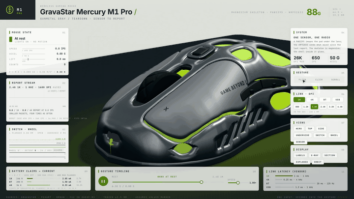
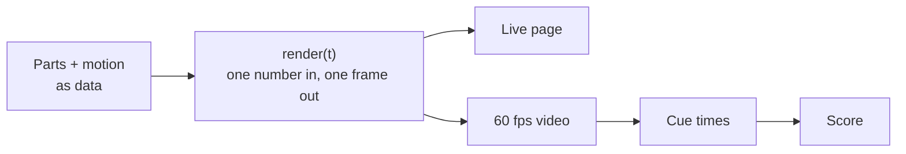

<div align="center">

# 3D Product Visualization

**A Claude Code skill that turns any product into an interactive 3D teardown and a cinematic launch video.**


[Watch the video](media/m1pro-film.mp4) · [Get started](#get-started) · [Your first scene](#your-first-scene) · [Use it with Claude](#use-it-with-claude) · [How it works](docs/how-it-works.md)



</div>

Tell Claude what to take apart. It models the product in 3D, pulls it into layers, cuts it open, slows down the one moment that matters, and scores the result: one offline page you can drive, and one video you can post.

## What you get

- **A live page.** One HTML file under 1 MB, no server. It tours itself until you touch it, then hands over control.
- **A cinematic launch video.** Speed-ramped slow motion, beat-matched camera cuts, numbered callouts and live cutaways, rendered one exact frame at a time instead of screen-recorded.
- **A generated score.** Every click, flick and cut is timed from the video itself; the mix is mastered to broadcast-style loudness.
- **Honest numbers.** Each value on screen is real, or marked as assumed.

| | Output |
|---|---|
| Live page | single offline `.html`, under 1 MB, three.js and fonts inlined |
| Video | 1920×1080 · 60 fps · H.264 + AAC stereo, deterministic frame-by-frame render |
| Score | procedural, −14 LUFS integrated, peaks under −2 dBFS |
| Timing | one `render(t)` drives all three, so picture and sound never drift |

The worked example is a gaming mouse, the GravaStar Mercury M1 Pro: a 4K-report flick, exploded layers, a sensor cutaway, and the switch closing at 0.30 mm in 20× slow motion.

## Three ways to use it

- **Ask Claude.** Describe the product; Claude builds the model, the edit and the score, and shows you stills as it goes.
- **Drive the page.** Open the live HTML, orbit it, explode it, press its buttons, scrub the slow-motion switch.
- **Own it as code.** A scene is plain JavaScript and one function of time, so you can diff it, tweak it and render it again.

## Use it when

- You need a launch-style video of a product that doesn't exist yet, or that you can't film.
- You want to explain how something works inside, not just how it looks.
- You want a shareable demo page with no server, accounts or plugins.
- You want the video re-rendered exactly after every change to the edit.

## One idea underneath



The picture depends only on the time `t`, so the page, the video and the sound can't drift apart.

## Get started

You need Node.js 20+ and `ffmpeg`. Python 3 is only needed for the sound.

1. **Get the project.** Clone the repo and open the folder.

   ```bash
   git clone https://github.com/Vedmeena21/3D-product-visualization
   cd 3D-product-visualization
   ```

2. **Install everything it needs.** One command for the web side, one for the sound.

   ```bash
   npm run setup
   pip install -r engine/requirements.txt
   ```

3. **Build the pages and open the live one.** Open `out/dist/m1pro-live.html` in your browser. The product tours itself; touch it and it's yours.

   ```bash
   npm run build
   ```

4. **Render the video.** Three commands in order: the cue times, the sound, then the picture. Join them with ffmpeg to get the finished video.

   ```bash
   npm run timeline
   npm run score
   npm run film
   ffmpeg -i out/m1pro-silent.mp4 -i out/m1pro-score.wav -c:v copy -c:a aac -shortest out/m1pro.mp4
   ```

5. **Check a few moments first, if you like.** Save stills at chosen seconds instead of rendering everything.

   ```bash
   node engine/capture.mjs m1pro-film --at 5,22,36.9 --out-dir out/stills
   ```

No graphics card? The video still renders, at about a second a frame, with this in place of `npm run film`:

```bash
PLAYWRIGHT_BROWSERS_PATH=0 node --import ./examples/m1pro/tools/swgl.mjs engine/capture.mjs m1pro-film --size 1600x900 --dpr 1.2 --out out/m1pro-silent.mp4
```

## Your first scene

The smallest scene in the repo is a cube. The whole idea is the last four lines: draw the frame for time `t`.

```js
import {runSim} from 'rig/film.js';

runSim({duration: 6, fps: 60}, async ({canvas, capture}) => {
  // … renderer, scene, camera, one cube (see examples/hello-cube/main.js)
  return {
    render(t) {
      cube.rotation.set(0.45, (t / 6) * Math.PI * 2, 0);
      renderer.render(scene, camera);
    },
  };
});
```

```bash
node engine/build.mjs hello-cube
node engine/capture.mjs hello-cube --out out/cube.mp4
```

The M1 Pro example is this same pattern with real parts, motion data and an edit.

## Use it with Claude

Put this repo in your skills folder and Claude Code picks it up:

```bash
git clone https://github.com/Vedmeena21/3D-product-visualization ~/.claude/skills/product-viz
```

Then ask in plain words:

> Build me a 3D teardown of the Sony WH-1000XM5 headphones and render a 30-second video.

> Make an exploded-view page for my mechanical keyboard, with a slow-motion key press.

Claude reads [SKILL.md](SKILL.md), researches the real dimensions, models the parts, edits the video, and shows you stills as it goes. Good first targets: anything with a mechanism you can see in motion, such as keyboards, cameras, watches, headphones and drones.

## Build one by hand

1. Copy `examples/m1pro/` to `examples/<product>/` and rename the folders.
2. Model the parts in real millimetres, grouped by layer.
3. Describe the motion as data: what moves, how far, when.
4. Write the edit as a timed script: cuts on the music's bars, one idea per shot.
5. Build, look at stills, fix, then render the timeline, score and video.

More: [docs/make-your-own.md](docs/make-your-own.md).

## Good to know

- Without a graphics card the video still renders, but takes about a second per frame.
- The mouse example uses public specifications; assumed values are labelled in the video.
- Contributions are welcome: a new example product is the most useful one.

## Licence

Created by [Vedmeena21](https://github.com/Vedmeena21). Copyright © 2026 Vedmeena21, released under the [MIT licence](LICENSE): you may use, change and share this code, including commercially, as long as this copyright notice and the licence text stay with it.

GravaStar and Mercury M1 Pro are trademarks of their owner. The mouse example is an independent study based on public specifications; it is not made, endorsed or sponsored by GravaStar.
