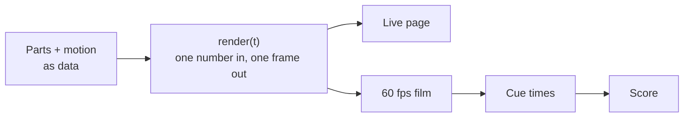

<div align="center">

# 3D Product Visualization

**A Claude Code skill that turns any product into an interactive 3D explainer and a 60 fps launch film.**


[Watch the film](media/m1pro-film.mp4) · [Get started](#get-started) · [Use it with Claude](#use-it-with-claude) · [How it works](docs/how-it-works.md)


</div>

Tell Claude what to take apart. It models the product in 3D, pulls it into layers, cuts it open, slows down the one moment that matters, and scores the result: one offline page you can drive, and one film you can post.

## What you get

- **A live page.** One HTML file under 1 MB, no server. It tours itself until you touch it, then hands over control.
- **A launch-style film.** The same scene rendered frame by frame at 1080p60, with speed ramps, camera cuts and callouts.
- **A generated score.** Every click, flick and cut is timed from the film itself and mastered to −14 LUFS.
- **Honest numbers.** Each value on screen is real, or marked as assumed.

The worked example is a gaming mouse, the GravaStar Mercury M1 Pro: a 4K-report flick, exploded layers, a sensor cutaway, and the switch closing at 0.30 mm in 20× slow motion.

## One idea underneath



The picture depends only on the time `t`, so the page, the film and the sound can't drift apart.

## Get started

You need Node.js 20+ and `ffmpeg`. Python 3 is only needed for the sound.

1. **Get the project.** Clone the repo and open the folder.

   ```bash
   git clone https://github.com/Vedmeena21/3D-product-visualization
   cd 3D-product-visualization
   ```

2. **Install everything it needs.** One command for the web side, one for the sound.

   ```bash
   npm run setup
   pip install -r engine/requirements.txt
   ```

3. **Build the pages and open the live one.** Open `out/dist/m1pro-live.html` in your browser. The product tours itself; touch it and it's yours.

   ```bash
   npm run build
   ```

4. **Render the film.** Three commands in order: the cue times, the sound, then the picture. Join them with ffmpeg to get the finished video.

   ```bash
   npm run timeline
   npm run score
   npm run film
   ffmpeg -i out/m1pro-silent.mp4 -i out/m1pro-score.wav -c:v copy -c:a aac -shortest out/m1pro.mp4
   ```

5. **Check a few moments first, if you like.** Save stills at chosen seconds instead of rendering everything.

   ```bash
   node engine/capture.mjs m1pro-film --at 5,22,36.9 --out-dir out/stills
   ```

No graphics card? The film still renders, at about a second a frame, with this in place of `npm run film`:

```bash
PLAYWRIGHT_BROWSERS_PATH=0 node --import ./examples/m1pro/tools/swgl.mjs engine/capture.mjs m1pro-film --size 1600x900 --dpr 1.2 --out out/m1pro-silent.mp4
```

## Use it with Claude

Put this repo in your skills folder and Claude Code picks it up:

```bash
git clone https://github.com/Vedmeena21/3D-product-visualization ~/.claude/skills/product-viz
```

Then ask in plain words:

> Build me a 3D teardown of the Sony WH-1000XM5 headphones and render a 30-second film.

> Make an exploded-view page for my mechanical keyboard, with a slow-motion key press.

Claude reads [SKILL.md](SKILL.md), researches the real dimensions, models the parts, edits the film, and shows you stills as it goes. Good first targets: anything with a mechanism you can see in motion, such as keyboards, cameras, watches, headphones and drones.

## Build one by hand

1. Copy `examples/m1pro/` to `examples/<product>/` and rename the folders.
2. Model the parts in real millimetres, grouped by layer.
3. Describe the motion as data: what moves, how far, when.
4. Write the edit as a timed script: cuts on the music's bars, one idea per shot.
5. Build, look at stills, fix, then render the timeline, score and film.

More: [docs/make-your-own.md](docs/make-your-own.md).

## Good to know

- Without a graphics card the film still renders, but takes about a second per frame.
- The mouse example uses public specifications; assumed values are labelled in the film.
- Contributions are welcome: a new example product is the most useful one.

## Licence

Created by [Vedmeena21](https://github.com/Vedmeena21). Copyright © 2026 Vedmeena21, released under the [MIT licence](LICENSE): you may use, change and share this code, including commercially, as long as this copyright notice and the licence text stay with it.

GravaStar and Mercury M1 Pro are trademarks of their owner. The mouse example is an independent study based on public specifications; it is not made, endorsed or sponsored by GravaStar.
